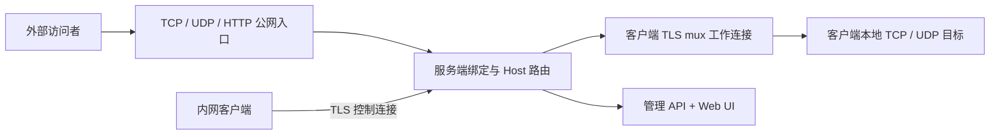

# 自部署内网穿透系统：Java + Netty 开发文档

当前实现：0.4.0（2026-09-22）。本文以仓库代码为准，描述 TCP 多路复用、UDP、HTTP/HTTPS 路由、动态映射、健康检查、负载均衡、限速和管理认证的实际实现与验收方式。

## 1. 已实现范围

- TLS 控制连接：客户端认证、规则注册、心跳、断线重连。支持兼容旧配置的共享 token，以及 `clientsFile` 中按 `clientId=token` 配置的独立客户端凭据。
- TCP 多路复用：每个客户端可建立多条 TLS 工作连接；所有 TCP/HTTP 流使用 `streamId + type + length + payload` 帧复用，并按连接可写状态做背压。
- UDP：服务端为每条 `udp.*` 规则监听一个 UDP 端口，按外部源地址建立逻辑流，保持每个数据报的边界。
- HTTP/HTTPS 路由：服务端监听 `httpPort` 或 `httpsPort`，支持 Host/SNI 回退、URL 前缀、Host 重写、Basic Auth 和 X-Forwarded-For。
- 动态映射：管理 API 可以新增、查询、删除客户端映射，并通过 `storeFile` 持久化，客户端重连后自动恢复。
- 健康与治理：支持 `health.*` 健康检查、`balance.*` 组负载均衡和 `bandwidth.*` 每映射限速。
- 管理界面：服务端默认 `127.0.0.1:8088` 提供运行态仪表盘和 JSON API，可查看客户端、映射和活动流，也可断开客户端；支持 `managementTokenFile` Bearer 认证和 `/metrics` Prometheus 指标。
- TLS、共享令牌、证书校验、端口范围限制、基本连接数配额和连接关闭清理。

资源边界：每客户端最多保留 512 个 UDP 逻辑流；连接建立前每流最多缓存 256 KiB、每客户端最多缓存 8 MiB，超过限制时丢弃新报文。HTTP 请求头必须在连接建立后的 15 秒内完整到达，头部上限为 64 KiB；同一批数据中的请求体不计入头部上限，转发时只改写请求头。管理映射表单最多 64 KiB，管理处理线程与等待队列均有上限。

当前仍未包含多服务端集群、TCP 半关闭保留、自动证书轮换和 QUIC/KCP/WebSocket 传输。HTTPS 入口使用服务端配置的证书终止 TLS，再按 Host/SNI 路由到客户端 HTTP 服务。

## 2. 网络架构



客户端有两条长期连接：

1. 控制连接：文本行协议，只传认证、规则注册、动态配置、健康状态、`OPEN`、心跳和错误。
2. 工作连接池：客户端按 `muxPoolSize` 建立 TCP/HTTP/HTTPS TLS 工作连接，并按 `udpMuxPoolSize` 建立 UDP 专用 TLS 工作连接；握手交换 `MUX 4 <TCP|UDP> <clientId> <token>`，随后转换成二进制 mux 帧。独立 UDP 池避免 UDP 突发排队阻塞 TCP 流，设为 0 时 UDP 回退到 TCP 池。UDP DatagramChannel 使用独立 I/O 线程池，避免 UDP socket 读写占用 TCP 工作线程；`udpIoThreads` 默认是检测 CPU 数的一半、最多 8 个。每个帧包含 4 字节大端 stream id、1 字节类型、4 字节大端 payload 长度和 payload，最大 payload 为 64 KiB。

帧类型为：

| 类型 | 方向 | 作用 |
| --- | --- | --- |
| `OPEN_TCP`（控制行 `OPEN`） | 服务端 → 客户端 | 请求客户端连接一条本地 TCP/HTTP 流。stream id 仍通过控制连接发送，数据在 mux 连接承载。 |
| `OPEN_UDP` | 服务端 → 客户端 | 请求客户端为一个外部 UDP 源地址连接本地 UDP 目标。 |
| `ACK` | 客户端 → 服务端 | 本地目标已经建立，可以开始转发。 |
| `DATA` | 双向 | 原始 TCP 字节或一个完整 UDP 数据报。大数据按 64 KiB 分片。 |
| `CLOSE` | 双向 | 关闭逻辑流及其两端资源。 |
| `PING` | 双向 | 连接级保活探测，使用 stream id `0` 和递增序号。 |
| `PONG` | 双向 | 对端返回对应序号；90 秒未收到有效响应则关闭 mux。 |

TCP/HTTP 字节路径是 `访问者 ↔ 服务端 Channel ↔ mux DATA ↔ 客户端本地 Channel ↔ 内网服务`。UDP 路径是 `访问者 DatagramPacket ↔ 服务端 UDP 监听 ↔ mux DATA ↔ 客户端 DatagramChannel ↔ 内网 UDP 服务`。

## 3. 配置

服务端配置：

```properties
bindHost=0.0.0.0
controlPort=7000
workPort=7001
publicBindHost=0.0.0.0
allowedPortStart=20000
allowedPortEnd=40000
httpPort=8080
httpBindHost=0.0.0.0
# httpsPort=8443
# httpsBindHost=0.0.0.0
managementPort=8088
managementBindHost=127.0.0.1
# managementTokenFile=/etc/tunnel/management-token
# storeFile=/var/lib/tunnel/mappings.properties
# muxPoolSize=2
# udpMuxPoolSize=1
# maxPendingBytes=8388608
tokenFile=/etc/tunnel/token
# clientTokenFile=/etc/tunnel/client-home-pc.token
certFile=/etc/tunnel/server.crt
keyFile=/etc/tunnel/server.key
```

客户端规则：

```properties
map.ssh=22022,127.0.0.1,22
udp.dns=25353,127.0.0.1,53
http.web=example.com|www.example.com,127.0.0.1,8080
```

`map.*` 是 TCP，`udp.*` 是 UDP，`http.*` 的第一个字段是 `|` 分隔的 Host 列表。HTTP 规则不占用 `allowedPortStart/allowedPortEnd` 范围，而是共享服务端的 `httpPort`/`httpsPort`。规则名和客户端 ID 只允许 `[A-Za-z0-9_-]`；Host 会被标准化为小写并去除末尾点。可选的 `http.<name>.locations`、`http.<name>.hostRewrite`、`http.<name>.basicUser`、`http.<name>.basicPassword` 分别配置路径、Host 重写和 Basic Auth；`balance.<name>=group,key`、`health.<name>=tcp|http,timeout,maxFailed,interval`、`bandwidth.<name>=1MB|1KB` 配置负载均衡、健康检查和限速。`tcp` 检查建连；`http` 向本地目标的 `/` 发起 GET，2xx/3xx 状态视为健康，使用 `hostRewrite` 时也会用该值作为健康检查的 Host。

## 4. 控制协议

TLS 建立后，客户端发送 `HELLO 2 <clientId> <token>`。登录成功后服务端返回 `HELLO_OK 2`，客户端根据规则类型发送：

```text
REGISTER <name> <remotePort> [group groupKey bandwidth health]
REGISTER_UDP <name> <remotePort> [group groupKey bandwidth health]
REGISTER_HTTP <name> <host1|host2> [locations hostRewrite basicUser basicPassword group groupKey bandwidth health]
```

服务端返回对应的 `*_OK` 或 `*_FAIL`。客户端收到服务端的 `OPEN <streamId> <ruleName>` 后连接本地 TCP 目标，并在 mux 工作连接发送 `ACK`。UDP 首个数据报到达时服务端发送 `OPEN_UDP`，客户端连接本地 UDP 目标后发送 `ACK`。

工作连接的明文登录行只允许出现在 TLS 握手之后；登录成功立即移除行解码器和 15 秒握手超时，替换为 `Mux.Decoder`、`Mux.Encoder` 和流处理器。mux 解码器拒绝非法 stream id、负长度和超过 64 KiB 的 payload；stream id `0` 仅用于连接级 PING/PONG 心跳帧。

## 5. HTTP Host 路由

服务端 `httpPort > 0` 时启动独立的明文 HTTP 监听。每个连接最多缓存 64 KiB 请求头，找到 `Host` 后在客户端注册表中查找精确域名（大小写不敏感）。命中后把包含请求头的原始字节作为该 mux 流的初始 payload 转发，因此不会重写 HTTP 方法、路径或请求头。未命中返回 404，缺少 Host 返回 400，超过头部限制返回 431。

HTTPS 入口由 Netty TLS 终止，读取 HTTP Host；缺少 Host 时使用 TLS ClientHello 的 SNI。当前仍是 HTTP/1.x 原始转发，不提供通配符证书和 HTTP/2。

## 6. 独立凭据、协议错误码和指标

服务端配置 `clientsFile` 后，每行按 Java properties 语法配置一个客户端身份，例如：

```properties
home-pc=home-pc-long-random-token-012345
office-pc=office-pc-long-random-token-012345
```

客户端使用 `clientTokenFile` 指向自己的 token 文件；未配置时仍使用旧的 `tokenFile`。控制和 mux 登录行都携带协议版本 `4`，mux 登录还标记 `TCP` 或 `UDP` 通道角色；错误统一返回 `ERROR <code> <detail>`，当前错误码包括 `AUTH_FAILED`、`VERSION_MISMATCH`、`CONFLICT` 和 `BAD_COMMAND`。

管理 API 配置 `managementTokenFile` 后要求 `Authorization: Bearer <token>`；管理页面会把 token 保存在浏览器本地存储。`GET /metrics` 输出低基数 Prometheus 指标，包括在线客户端、mux 连接、活动流、流生命周期、字节数、认证失败数，以及 UDP 公网出口批次排队时间和每 64 个 socket 写中抽样的完成时间。

动态映射使用 `storeFile` 持久化。保存时先写同目录临时文件，再原子替换；保存失败不会修改内存映射或向客户端发送配置变更。管理 API 以 `application/x-www-form-urlencoded` 接收新增映射，例如 `POST /api/clients/home-pc/bindings` 的字段包括 `name`、`kind`、`remotePort`、`localHost`、`localPort`、`hosts`、`locations`、`balanceGroup`、`balanceKey`、`health` 和 `bandwidth`；`GET` 查询，`DELETE /api/clients/<id>/bindings/<name>` 删除。新增和删除会通过控制连接同步到客户端。

## 7. UDP 设计

服务端每条 UDP 规则绑定一个 `NioDatagramChannel`。外部源地址（IP+端口）是逻辑流的 key；服务端为该 key 分配 stream id，并把每个 `DatagramPacket` 原样作为一帧 `DATA` 发送。客户端为每个逻辑流创建一个已连接的 `NioDatagramChannel`，目标固定为规则声明的本地地址。120 秒没有数据后逻辑流清理。

UDP 不提供 TCP 式顺序、重传或拥塞控制；mux 工作连接本身使用 TCP，因此公网 UDP 的包会受工作连接的可靠传输影响，适合 DNS、游戏控制包等低速场景，不等价于原生 UDP 性能。

## 8. 管理 API 与界面

管理服务使用 JDK 自带 `HttpServer`，不占用 Netty 工作端口：

| 方法 | 路径 | 作用 |
| --- | --- | --- |
| `GET` | `/` | 深色运维仪表盘，3 秒刷新。 |
| `GET` | `/api/status` | 返回在线客户端、mux 状态、规则类型/端口/域名和活动流数量。 |
| `POST` | `/api/clients/<clientId>/disconnect` | 关闭指定客户端控制连接，客户端会按退避策略重连。 |
| `GET` | `/api/clients/<clientId>/bindings` | 查询动态映射。 |
| `POST` | `/api/clients/<clientId>/bindings` | 以表单新增或更新动态映射。 |
| `DELETE` | `/api/clients/<clientId>/bindings/<name>` | 删除动态映射。 |
| `GET` | `/metrics` | 输出 Prometheus 文本格式指标。 |

默认只绑定回环地址；如果必须远程访问，应通过防火墙、VPN 或带认证的反向代理暴露，不能直接把未认证管理 API 发布到公网。

## 9. 代码结构与验收

```text
Settings.java       规则类型、端口、Host 和配置校验
DynamicStore.java   动态映射持久化与控制消息编码
Metrics.java        Prometheus 指标采集与输出
Wire.java           控制行和认证辅助
Mux.java            mux 帧编码/解码、64 KiB 上限
Server.java         控制服务、公网 TCP/UDP/HTTP、mux 服务端、状态快照
Client.java         控制注册、mux 客户端、本地 TCP/UDP 目标、重连
Management.java     管理 API 和静态界面服务
Relay.java          旧的直连转发辅助（保留作兼容代码）
Smoke.java          TLS/TCP/复用/重连集成测试
FeatureSmoke.java   UDP、HTTP Host、管理 API 集成测试
```

标准环境运行。`mvn test` 自动执行 `Smoke`、`FeatureSmoke` 和 `MuxKeepaliveSmoke`；`mvn package` 也会执行这些检查：

```sh
mvn test
```

性能验收：

- `PerformanceSmoke`：预热 32 MiB 后，单条 TCP/TLS/mux 链路重复传输 3 次、每次 256 MiB，输出吞吐中位数、范围，以及测量期间的进程/系统 CPU；可通过 `-Dtunnel.test.flowWindowBytes=<bytes>`、`-Dtunnel.test.tcpNoDelay=false` 和 `-Dtunnel.test.flushMode=balanced` 对比流控窗口、Nagle 开关和刷新模式。
- `StressSmoke <clients> <connectionsPerClient> <seconds> <muxPoolSize>`：多客户端、多 TCP 流持续回环，输出吞吐、平均回显延迟、错误数、测试 JVM CPU 峰值和堆峰值。
- 压测默认应先使用低负载，例如 `StressSmoke 2 2 30 2`；本机回环结果只能作为回归基线，不能直接当公网容量承诺。
- `muxPoolSize` 是单客户端 TCP/HTTP 的 TLS 工作连接池大小；`udpMuxPoolSize` 是 UDP 专用工作连接池大小，默认各 1。单客户端高并发时增加对应池会提高并行度，也增加 TLS 连接、线程和内存开销，需在目标机器上权衡；两端的池大小必须匹配。`udpIoThreads` 单独控制 UDP socket I/O 线程数，默认是检测 CPU 数的一半、最多 8 个；客户端和服务端可分别调整。
- `udpMuxStriping` 默认关闭；客户端和服务端同时开启且 `udpMuxPoolSize > 1` 时，同一 UDP 流的数据批次会跨 UDP mux 连接轮转，可分散单条 TCP/TLS 连接的写队列。报文可能跨连接乱序；依赖严格顺序的 UDP 应用保持关闭。该选项只对 UDP mux 池生效，不会把 UDP 帧发到 TCP mux 池。
- 客户端和服务端的 `udpMuxWriteBufferHighWaterMarkBytes` 分别控制各自 UDP 专用 TLS mux 的 Netty 写缓冲高水位，默认 8 MiB（范围 64 KiB–16 MiB）；写队列到达该值后暂停继续排空待发送 UDP 批次，待队列下降后再恢复。较低水位会在过载时更早施加背压，也可能增加 UDP 丢包；应按目标链路压测调整。

当前 TCP/UDP 数据面使用引用计数 `ByteBuf` 和保留切片，帧头与数据体由双组件 `CompositeByteBuf` 组合；超过 64 KiB 的 TCP 数据按切片分帧，解码使用 composite cumulator 和 `readRetainedSlice`。这减少应用层复制，TLS 加密仍会生成密文。HTTP/HTTPS 仅改写有界请求头，首包请求体通过组合缓冲区保留，后续数据直接切片转发。UDP 两端接收缓冲区设为 64 KiB，待发送队列改为引用计数缓冲区，每流最多排队 256 个报文且保留原有字节配额；聚批时不超过 256 字节的小报文复制到连续块以降低组件数量，大包保留切片；小于 4 KiB 且底层缓冲区容量超过有效数据 8 倍时，排队采用紧凑复制，避免小报文长期占用大内存。转发给其他连接前保留引用，原始帧由入站处理器释放；待发送队列在发送或关闭时释放引用。

`flushMode=latency` 为两端默认策略：只合并正在进行的读批次内的 flush，读完成即刷新；读批次外直接刷新。`flushMode=balanced` 还会把读批次外的 flush 合并到 EventLoop 后续任务，不等待固定字节数或毫秒数，但也不承诺硬实时上限。两种模式都在累计 64 次 flush 请求或连接不可写时刷新；控制连接不参与合并。工作连接的处理顺序为 TLS、flush 合并器、mux 解码器、mux 编码器、保活和帧处理器，使出站 flush 在进入 TLS 前合并。

所有 TCP socket 默认启用 `tcpNoDelay=true`，减少小块交互数据受 Nagle 算法影响的等待；可在两端配置为 `false`，并用交错的吞吐/延迟测试决定是否适合目标网络。

`MuxBufferSmoke` 覆盖组合帧共享数据、引用释放、拆包、64 KiB 分片、空数据报，以及读完成、孤立小包和 flush 次数上限的刷新进度；它随 `MuxKeepaliveSmoke` 在 `mvn test` 中执行。修改后应运行 `mvn test` 和低负载 `StressSmoke`，并用小包延迟及慢接收端测试评估不同刷新策略。

验收必须覆盖：TCP 二进制往返、1 MiB 分片、并发短连接、客户端重启和多 mux；UDP 数据报边界和回包；HTTP/HTTPS Host/SNI、路径路由和未知 Host；健康检查、动态映射增删、管理 API 状态和断开动作。发布前还应补充错误凭据、端口冲突、mux 握手超时、慢读、资源上限和证书轮换测试。

## mux 工作连接保活

mux 握手成功后，客户端和服务端每 20 秒发送连接级 PING，收到后回复相同序号的 PONG；连续 90 秒未收到有效 PONG 时关闭该 mux。客户端观察到 mux 关闭后按 1、2、4…最多 30 秒的退避间隔重连，并分别补足 `muxPoolSize` 和 `udpMuxPoolSize`。协议版本 4 在工作连接登录时标记 TCP/UDP 通道角色；正在故障 mux 上的数据流会随连接关闭而失败，重连只恢复连接池容量。

TCP 流窗口：协议版本 4 为 TCP/HTTP/HTTPS 每个逻辑流在 ACK 和初始 WINDOW 阶段双向协商发送额度；`flowWindowBytes` 默认 256 KiB，范围为 64 KiB 到 64 MiB；`maxFlowWindowBytes` 默认为每个客户端会话 512 MiB 的总窗口预算。发送端耗尽额度后暂停该目标连接读取；接收端在目标 socket 写入完成后归还额度。小额归还合并到 64 KiB 或最多 1 ms 后发送，数据帧本身不等待该合并。UDP 保持独立报文语义，不走字节窗口；同一 EventLoop 读批次内的多个报文可合并进 UDP_BATCH 帧，并按长度字段还原边界。客户端把收到的 UDP_BATCH 立即排入本地 UDP socket EventLoop，每轮最多处理 16 批并刷新一次，不用定时器等待攒批；每流最多 256 KiB/2048 批次/8192 报文，等待超过 100 ms 的批次会丢弃。客户端本地 UDP 回包跨 EventLoop 写入 UDP 专用 mux 时也经过单会话最多 512 KiB/2048 批次的队列；同一流排队的 UDP_BATCH 使用 CompositeByteBuf 零拷贝合成单帧，每次排空最多取 16 批、单帧不超过 64 KiB，立即调度并刷新一次；mux 不可写时等待可写事件，同样丢弃超过 100 ms 的旧批次，不额外等待定时攒批。服务端公网 UDP 出口采用相同的立即排空方式，每轮最多处理 16 批并刷新一次；调度队列按 listener 最多 65536 个报文、每客户端最多 8 MiB，并在队列等待超过 100 ms 时丢弃过时报文，避免过载后继续发送迟到数据。进入 Netty 未完成写后，每访客最多 2048 报文、512 KiB。超过队列上限或写失败时 UDP 按 best-effort 丢弃；服务端 `tunnel_udp_dropped_total` 汇总这些丢包。`udpSocketBufferBytes` 调整系统 UDP 发送/接收缓冲：客户端默认 256 KiB/流，服务端默认 1 MiB/监听器，增大时会提高突发承载并增加内存占用。`udpMuxPoolSize` 默认 1，客户端和服务端必须一致；设为 0 时 UDP 复用 TCP 工作连接并重新承受 TCP 队头阻塞。协议版本 3 与版本 4 不兼容，升级时客户端和服务端需同时更新。

UDP 压测可运行 `java -Dtunnel.test.udpPackets=50000 -Dtunnel.test.udpPaceNanos=100000 -cp "target/test-classes;target/tunnel-0.4.0.jar" dev.tunnel.FeatureSmoke --udp-perf`；不设缓冲覆盖参数时使用客户端 256 KiB、服务端 1 MiB 的默认 UDP socket 缓冲。`-Dtunnel.test.udpSocketBufferBytes=<bytes>` 可覆盖两端缓冲。默认详细计时会报告请求方向、echo、客户端 UDP 收包和写入完成、mux 到服务端解码等阶段 p95。吞吐基准可加 `-Dtunnel.test.detailedUdpPerfStats=false` 关闭每包阶段打点，减少测量开销。压测时也可用 `-Dtunnel.test.udpMuxPoolSize=2 -Dtunnel.test.udpMuxStriping=true` 对比单流分片；该测试属性会同时设置两端。
UDP 空报文限制：当前 Netty NIO UDP 发送路径会忽略空报文，不能把 mux 层空帧测试当作端到端 UDP 支持。FeatureSmoke 新增 65,507 字节报文、同来源混合长度报文、HTTP/HTTPS 96 KiB 完整与分段请求体验证。

背压恢复顺序：工作连接变为可写时，先把排队恢复操作提交到该连接 EventLoop 的后续任务，再恢复源连接读取。不能在写完成引发的可写回调中直接发送后续排队数据，否则可能越过先前从其他 EventLoop 提交、尚未执行的写任务。客户端和服务端均采用相同处理。

FeatureSmoke 的 HTTPS 请求体使用固定种子的随机内容，并重复验证完整和分段发送，以检查背压恢复后的数据顺序。另可用 `java -Dtunnel.test.flushMode=balanced -cp "target/test-classes;target/tunnel-0.4.0.jar" dev.tunnel.FeatureSmoke` 检查 balanced 刷新模式；该系统属性仅用于测试配置。
